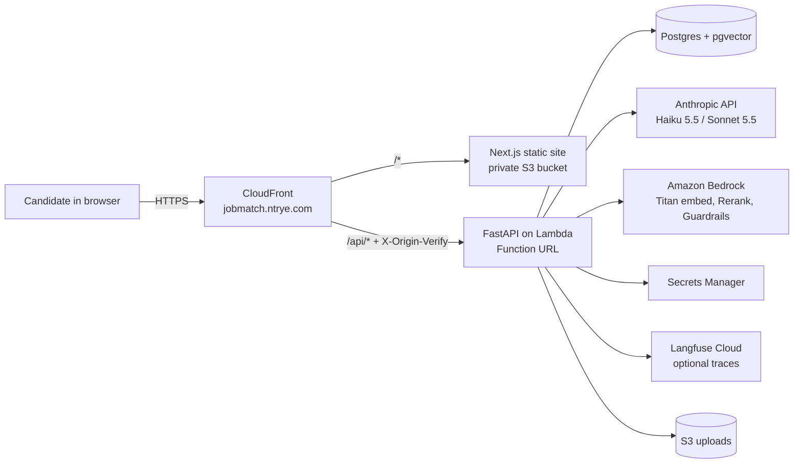
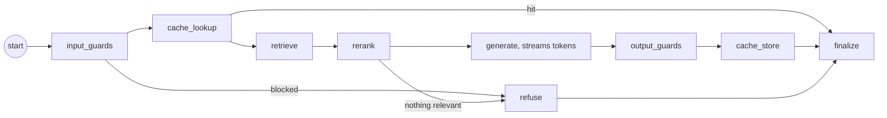

# JobMatch AI: architecture (HLD + LLD) and why it is built this way

About a 20-minute read. Part 1 is the high-level design, Part 2 the low-level design,
Part 3 the decisions we weighed and why we picked what we did. Things that are designed
but **not built yet** are marked *(planned)*.

Status at the time of writing: Phases 1 to 8 are built (backend,
ingestion, RAG chat, match analysis, suggestions, guardrails, observability, cost
controls, evals, email sign-in, AWS CLI deploy, Next.js frontend behind CloudFront).

---

## Part 1: High-level design

### 1.1 What the product does

A candidate uploads a resume (PDF) and pastes a job description. The system:

1. **Ingests** both: parses, chunks by section, embeds, stores in Postgres + pgvector.
2. **Analyses the match:** extracts the JD's requirements and the resume's skills, matches
   them with quoted evidence, and computes a score.
3. **Suggests rewrites** of resume bullets aimed at the JD, without inventing anything.
4. **Answers questions** about the two documents in a chat that cites its sources.

The feature is the vehicle. The point of the project is to show **production-grade LLM
engineering**: guardrails, evaluation, observability, cost control and reliability are
requirements, not extras.

### 1.2 Non-negotiable constraints

| Constraint | Consequence in the design |
|---|---|
| Budget about $15/month, $100 AWS credits | Serverless only, nothing billed per hour, a $1/day global spend cap |
| Claude through the Anthropic API (credits don't cover Claude on Bedrock) | Claude via `langchain-anthropic`; Titan embeddings, Rerank and Guardrails stay on Bedrock |
| Every secret in AWS Secrets Manager; public repo | No hand-written `.env`; `make env` generates one from Secrets Manager; CI uses OIDC, never stored keys |
| No PII in logs, traces or tables | A single redaction function at every boundary |
| Must work offline | Fake LLM, hash embedder, no-op reranker; tests and CI need no keys |

### 1.3 System context

Locally the same API runs in Docker Compose next to a `pgvector/pgvector:pg17` container.

### 1.4 Main building blocks

| Layer | Responsibility | Where |
|---|---|---|
| API | Routes, SSE streaming, request id, request log, identity seam | `app/api`, `app/main.py` |
| Ingestion | PDF parse, section chunking, embedding, injection scan, quarantine | `app/ingestion` |
| Retrieval | Vector + full-text search, RRF fusion, rerank | `app/retrieval` |
| Graphs | LangGraph workflows for chat, match, suggestions | `app/graphs` |
| Analysis | Analyst protocol (Claude or heuristic), grounding, deterministic score | `app/analysis` |
| Guardrails | Pipeline per stage, self-built guards, Bedrock provider, event recorder | `app/guardrails` |
| LLM layer | Model factory, fallback, structured outputs, pricing | `app/llm` |
| Observability | Usage ledger, request log, Langfuse tracing | `app/observability` |
| Cache | Semantic cache for chat answers | `app/cache` |
| Evals | Golden dataset, runner, metrics, judge, gate | `backend/evals`, `evals/` |

### 1.5 The four flows at a glance

### 1.6 Cross-cutting qualities

- **Security:** secrets only in Secrets Manager; per-user data isolation on every query;
  PII redacted before logs and traces; injection in documents is quarantined.
- **Reliability:** timeouts on every call; retries only on retryable errors (429, 5xx,
  connection); Haiku to Sonnet fallback; friendly errors with a request id.
- **Cost:** cheap model by default; per-user daily allowances; a global daily spend cap;
  a semantic cache; prompt caching on analysis context; every request's cost is logged.
- **Observability:** a `request_log` row per API request (route, models, tokens, cost,
  cache hit, latency, guardrail outcomes; no text); `make report` gives p50/p95 and cost
  per route; optional Langfuse traces with PII masking.
- **Quality:** a 33-case golden dataset with adversarial cases and a threshold gate in CI.

### 1.7 Deployment view *(built, Phases 7 and 8)*

- **Compute:** one container image on Lambda (Lambda Web Adapter keeps FastAPI unchanged),
  behind a single public Function URL with response streaming for SSE. There is no API
  Gateway: CloudFront is the front door (see Edge). Readiness uses `/livez`, which
  never touches the database, so a cold start does not fail on a sleeping Neon instance.
- **Edge (Phase 8):** CloudFront serves `https://jobmatch.ntrye.com` with an ACM certificate
  (us-east-1) and a Route 53 alias. The default behaviour reads the static export from a
  private S3 bucket through origin access control; a CloudFront Function rewrites `/app/` to
  `/app/index.html`. `/api/*` has caching off and goes to the Function URL, with a secret
  `X-Origin-Verify` header added (see 2.12). The Route 53 zone is the author's, edited by hand;
  the scripts touch only the `jobmatch` alias and the certificate validation records.
- **Data:** Neon Postgres with pgvector (free tier); uploads go to a private S3 bucket
  (objects expire after 3 days).
- **Secrets:** `make secrets-set` writes `jobmatch/prod` by prompt, so values never reach
  scripts, state or the Lambda environment (which holds settings only).
- **Ops:** AWS Budgets email alerts at $10 and $25; reserved concurrency 5 (may be refused
  on new accounts); a second Lambda (same image, `CLEANUP_MODE`) run hourly by EventBridge
  Scheduler deletes documents, cache rows, login codes and usage counters older than 72
  hours; CloudWatch log retention 14 days.
- **Provisioning:** AWS CLI scripts in `infra/aws/` (see 3.11), not Terraform. `make deploy`
  builds the infrastructure, `make deploy-frontend` builds `frontend/` and syncs it to S3
  (hashed assets cached a year, everything else revalidated) and invalidates CloudFront.
- **CI:** the GitHub OIDC role for evals is still not created.

---

## Part 2: Low-level design

### 2.1 Data model (Postgres, Alembic migrations 0001 to 0007)

| Table | Key columns | Notes |
|---|---|---|
| `users` | `id`, `email`, `created_at`, `last_seen_at` | Set at sign-in |
| `documents` | `user_id`, `doc_type` (resume/jd), `source`, `status` (processing/ready/failed), `content_sha256`, `embed_model` | Unique index: one `ready` document per user per type |
| `chunks` | `user_id`, `doc_id`, `doc_type`, `section`, `ordinal`, `text`, `embedding vector(1024)`, `tsv` (generated), `quarantined` | HNSW index (cosine) on embedding, GIN on `tsv` |
| `analyses` | `user_id`, `resume_doc_id`, `jd_doc_id`, `analyst`, `result` (JSONB) | Unique per document pair and analyst, so it doubles as the analysis cache |
| `guardrail_events` | `request_id`, `user_id`, `stage`, `guardrail`, `provider`, `action`, `mode`, `reason`, `latency_ms` | `reason` is a fixed code, never text |
| `usage_counters` | `user_id`, `kind`, `window_start`, `count` | Daily allowances and the per-minute burst limit |
| `request_log` | route template, method, status, models, tokens incl. cache read/write, `cost_usd`, `cache_hit`, latency, guardrails | One row per `/api` request; no text |
| `semantic_cache` | `user_id`, `doc_set_hash`, `embedding`, `payload`, `expires_at` | 72-hour TTL |

Every row hangs off `users` with `ON DELETE CASCADE`, so deleting a user removes all of
their data. The evals use this: each case runs as a throwaway user.

### 2.2 Ingestion

1. **Upload validation:** MIME sniff, extension, at most 5 MB, at most 10 pages. Scanned
   PDFs (no extractable text) are rejected with a clear message.
2. **Parse** with `pypdf`. JDs arrive as text (50 to 20,000 characters).
3. **Chunk by section.** Headings (Summary, Experience, Skills, Projects, Education; for JDs
   Responsibilities, Requirements, Nice to have) are detected from an alias table. Long
   lines are split by sentence, then by word, under a character cap.
4. **Upload guardrails:** injection rules, then the Haiku injection classifier, then
   optionally Bedrock prompt-attack. A chunk that trips them is **quarantined**: stored and
   flagged, never sent to a model. If every chunk is quarantined, the document fails with
   `document_quarantined`.
5. **Embed** with Titan V2 (1024 dimensions, normalised) or the offline hash embedder.
   The embedder id is stored on the document, so a provider switch cannot mix vector spaces.
6. Re-uploading identical content (same SHA-256 and embedder) reuses the stored chunks.

Events stream back over SSE (`progress`, then `done` or `error`).

### 2.3 Retrieval

- **Vector search:** cosine distance on the HNSW index, top `k = 20`.
- **Full-text search:** `websearch_to_tsquery` on the generated `tsv`, top 20.
- Both filter by `user_id`, the active document ids, and `quarantined = false`.
- **Fusion:** Reciprocal Rank Fusion with constant 60. RRF uses ranks, not raw scores, so
  cosine distances and `ts_rank` never have to be put on one scale.
- **Rerank:** Amazon Rerank 1.0 keeps the top 6. Offline, a no-op reranker.
- **Refusal:** if every reranked chunk scores below `min_relevance = 0.2`, the chat refuses
  ("not in the documents") instead of guessing.
- **Determinism:** ties sort by `doc_type`, then `ordinal`, so the same query always returns
  the same order. The eval gate depends on this.

Chunks are labelled `r1, r2 …` (resume) and `j1, j2 …` (JD); the model cites those labels
inline and the API maps them back to chunk ids.

### 2.4 Chat graph (LangGraph)

- **Input guards** (in order): PII redaction, injection rules, injection classifier, topic
  classifier, optional Bedrock. A blocking guard in `enforce` mode stops the request with a
  fixed refusal; in `monitor` mode it only logs.
- **Generate** streams tokens to the client immediately.
- **Output guards:** the answer is split into claims and each claim is checked against the
  chunks it cites (Haiku judge; a lexical-overlap check offline). The result arrives as a
  final `verdict` SSE event, and the UI replaces an ungrounded answer.
- **Cache:** only when every guard returned `allow`, in both directions.

SSE events: `progress`, `token`, `verdict`, `done` (answer, citations, invalid citations,
refused, blocked, cached, guardrail outcomes, request id).

### 2.5 Match analysis graph

`extract_jd_requirements → extract_resume_skills → match_with_evidence → validate → score → finalize`

- Every step is a **structured output** (Pydantic schema via JSON-schema structured output).
  If validation fails, the call is retried with the error fed back, then escalated to Sonnet.
- **Validate (hallucination block):** each evidence quote must appear in the cited chunk
  after normalisation. A match whose quotes don't hold up is downgraded, and the downgrade
  is logged as a guardrail event.
- **Score is deterministic:** `round(100 × Σ weight × credit / Σ weight)` with weights
  required = 3, nice-to-have = 1 and credits matched = 1, partial = 0.5, missing = 0. The
  model never chooses the number, so the score is explainable and testable.
- Results are cached per (resume document, JD document, analyst version).

### 2.6 Suggestions graph

`select_relevant_bullets → rewrite → validate → finalize`

Bullets are ranked by how many target skills they mention. The rewrite must cite its
source bullet. **Validate** rejects any rewrite that introduces a capitalised term,
employer, metric or target skill not present in the source bullet. Rejections are counted
and logged as hallucination blocks.

### 2.7 Model layer

- `make_chat_model(settings, model, max_tokens, timeout, effort)` returns `ChatAnthropic`
  or the offline `GenericFakeChatModel`. `max_tokens` and `effort` are explicit per call
  site (`low` for guards, `medium` for generation).
- **Routing:** Haiku for chat, guards and the first structured attempt; Sonnet when the
  input exceeds 24,000 characters or structured validation fails twice.
- **Fallback:** `with_fallbacks` from Haiku to Sonnet, only on `RateLimitError`,
  `InternalServerError` and `APIConnectionError`. Never on 400, 401 or 404.
- **Structured outputs** use `method="json_schema"`, because Sonnet 5.5 rejects forced
  `tool_choice`.
- **Prompt caching:** `cache_control` on the analysis context block. System prompts are
  below the 512-token minimum, and chat context changes per question, so those are not cached.
- Prompts are versioned files in `backend/prompts/`; the version tags every trace.

### 2.8 Guardrails

- **Interface:** `Guardrail.check(ctx) -> GuardrailResult(action, reason, provider, latency)`,
  where action is `allow | redact | flag | block | error`.
- **Pipeline:** an ordered list per stage (`upload`, `chat_input`, `output`). Each guard is
  configurable as `off`, `monitor` or `enforce`.
- **Every firing** writes a `guardrail_events` row and appears in the response.
- **Self-built guards:** regex injection rules, a Haiku injection classifier, a Haiku topic
  classifier, PII (regex plus Presidio for addresses), per-claim groundedness. A claim that cites sources is judged against those; an uncited
  claim is judged against all retrieved context, so a correct but uncited sentence is not
  flagged merely for lacking a label.
- **Bedrock provider:** `ApplyGuardrail` with a numbered version (never DRAFT), tracing off.
  Planned to run in `monitor` mode so both verdicts can be shown side by side.
- **Allowances:** per user per UTC day, 5 analyses, 10 uploads, 30 chats and 10
  suggestions, plus 10 requests per minute.
- **Global spend cap:** if today's logged model + Bedrock cost reaches $1, expensive routes
  return 503 "The demo is at capacity today" before any allowance is consumed.

### 2.9 Observability and cost

- A **usage ledger** (`RequestUsage`) lives in a context variable for the life of a request.
  A LangChain callback on every `ChatAnthropic` adds tokens and cost, including cache reads
  and writes; Bedrock calls add their list price.
- A pure ASGI **request-log middleware** writes one `request_log` row per `/api` request,
  using the route template (never the raw path, which could hold PII).
- **Langfuse** is on only when both keys are present. Every traced string goes through the
  PII redactor; traces carry the user id and request id, never an email.
- **Semantic cache:** grounded chat answers reused per user and document set at cosine
  ≥ 0.95, 72-hour TTL; cleared when the user uploads a new document.

### 2.10 Sign-in *(built, Phase 7)*

Email one-time-code sign-in. `POST /api/auth/request-code` always answers 202; `verify`
checks the code and sets an httponly session cookie (HMAC-signed, stateless, 7 days);
`me` and `logout` complete the set. Codes are 10-minute, single-use, with 5 attempts each; limits are 3 per email and 10 per IP per hour, and disposable
domains are refused. Login codes store only HMAC digests of the email and code, and emails are never logged. The client IP
comes from `X-Forwarded-For` using `trusted_proxy_hops` (1: the Function URL is the only
hop). Email goes through Resend when deployed and through a console sender locally (the
code lands in the API log; refused when `ENV=prod`). `get_current_user_id` reads the
cookie in deployed environments and keeps the fixed dev user only in `local`/`ci`.

### 2.11 Web frontend *(built, Phase 8)*

`frontend/` is a Next.js static export (`output: "export"`, React, Tailwind). `/` is the
sign-in screen and `/app/` the signed-in app: documents (upload through the presigned
ticket, paste text, or load samples), analysis and suggestions, and chat with clickable
citations and a "Show guardrails" panel. SSE endpoints are POSTs, so `lib/sse.ts` reads
`fetch` streams rather than `EventSource`. Session restore uses read-only endpoints that
spend no allowance: `GET /api/documents`, `/api/analyses/latest`, `/api/suggestions/latest`
and `/api/chunks/{id}` (citation text), all in `api/session_state.py`. No document text or
email goes into browser storage. Rewrites are not allowed in a static export, so `next dev`
proxies `/api/*` to `localhost:8000` and CloudFront does the same in production. Tests:
Vitest unit tests (`make fe-test`) and a Playwright flow against the offline API
(`make fe-e2e`), both in CI.

### 2.12 Origin verification *(built, Phase 8)*

The Function URL stays public, so anyone could call it and skip the distribution. `deploy.sh`
generates `ORIGIN_VERIFY_TOKEN` into the `jobmatch/prod` secret; CloudFront sends it as
`X-Origin-Verify` on `/api/*`, and a pure-ASGI middleware (`core/origin_verify.py`) answers 403
to any `/api/*` request without a matching token (constant-time compare). `/health` and
`/livez` are exempt, and with no token configured the check is off so local runs and Phase 7
deployments work unchanged.

### 2.13 Evaluation harness (Phase 6)

- **Dataset:** 33 synthetic cases across 11 categories (strong, partial and poor match,
  career changer, missing information, injection in resume, in JD and in chat, off-topic
  chat, PII-heavy resume, requests to fabricate), 109 chat questions, rendered PDFs, and
  expected matched/partial/missing skills and score band. About half fail today on purpose.
- **Runner:** each case goes through the real ingest, analysis, suggestion and chat code
  as a throwaway user. Guardrail outcomes are captured in memory; app logs are captured and
  searched for the planted fictional PII.
- **Metrics:** skill F1, score-band accuracy, refusal correctness, hallucination-block rate,
  context hit rate, catch and false-positive rates per guardrail and per provider (counting
  only input-stage guards), p50/p95 latency, cost. Live runs add four DeepEval metrics
  judged by Sonnet 5.5.
- **Gate:** `evals/thresholds.yaml` with an `offline` and a `live` profile. A missing or
  non-finite metric fails the gate.
- **CI:** the offline gate runs on every PR including forks; the live job runs only for
  this repo's own PRs and `main`, through OIDC, once the OIDC role is created (not yet).

---

## Part 3: Approaches we weighed and why we chose these

Each entry: the options, the choice, and the reason. "Cost if wrong" is what we'd pay to
change our mind later.

### 3.1 Database: Postgres + pgvector (not a dedicated vector DB)

- **Options:** Pinecone or another hosted vector DB; OpenSearch; Postgres with pgvector.
- **Chosen:** Postgres + pgvector, hosted on a serverless free tier (Neon) when deployed.
- **Why:** one database holds documents, chunks, analyses, events, counters, logs and the
  cache, so per-user isolation, cascading deletes and transactions come for free. Postgres
  full-text search gives hybrid retrieval without a second system. The data volume (a few
  dozen chunks per user) is tiny, so a dedicated vector DB would add cost and moving parts
  for no benefit. RDS or Aurora would bill hourly, which breaks the budget rule.
- **Cost if wrong:** swap the `Retriever` implementation; the graphs don't change.

### 3.2 Hybrid retrieval with RRF and rerank (not vector-only)

- **Options:** vector-only; BM25-only; hybrid with score blending; hybrid with RRF + rerank.
- **Chosen:** vector + full-text, fused by RRF, then Amazon Rerank.
- **Why:** resumes are full of exact tokens (Kafka, Terraform, "5+ years") that embeddings
  blur and keyword search nails, while paraphrased questions need embeddings. RRF combines
  them without calibrating two incompatible score scales. A reranker then fixes ordering at
  a fraction of a cent per query. We captured a vector-only baseline first so the gain is
  measured, not assumed.
- **Cost if wrong:** a settings switch (`retrieval_mode`, `reranker_provider`).

### 3.3 LangGraph workflows (not a free-running agent)

- **Options:** an agent choosing its own tools; plain function calls; LangGraph graphs.
- **Chosen:** small, fixed LangGraph graphs.
- **Why:** every flow here is a known sequence. A fixed graph makes each step testable,
  traceable as a span, and easy to put a guard in front of or behind. An agent would add
  latency, cost and unpredictability with nothing to gain, and would be much harder to
  evaluate.
- **Cost if wrong:** low; a node can call a model with tools later if a flow needs it.

### 3.4 Deterministic score (not an LLM-chosen number)

- **Chosen:** the model extracts and matches with evidence; code computes the score.
- **Why:** a number the model picks drifts between runs and can't be explained or tested.
  A weighted formula over validated matches is reproducible, explainable to a candidate,
  and lets the eval check score bands exactly.

### 3.5 Grounding by construction (not "please don't hallucinate")

- **Chosen:** evidence quotes must appear verbatim in the cited chunk; rewrites may not add
  terms that are absent from the source bullet; chat claims are checked against their
  citations.
- **Why:** the worst failure for this product is inventing experience. Code checks are
  cheap, deterministic and testable; prompt wording alone is not a control.

### 3.6 Guardrails: hybrid self-built + Bedrock (not one or the other)

- **Options:** self-built only; Bedrock Guardrails only; both behind one interface.
- **Chosen:** both, behind `Guardrail.check`, each guard set to `off`, `monitor` or `enforce`.
- **Why:** self-built guards are explainable and run offline in tests; Bedrock adds a
  managed second opinion. One interface lets the evals compare catch rates per provider,
  and `monitor` mode allows trying a guard in production without blocking users. Every
  firing is logged, because a guard that fires silently is an anti-goal.
- **Cost if wrong:** a config change per guard.

### 3.7 Stream first, verify after (not buffer-then-check)

- **Chosen:** stream tokens immediately; the groundedness verdict arrives as a final event,
  and the UI replaces a failed answer.
- **Why:** buffering until the check finishes would add seconds before the first token.
  The trade-off is that a user may briefly see an ungrounded sentence; that is documented.

### 3.8 Claude via the Anthropic API, Haiku first (not Sonnet everywhere, not Bedrock Claude)

- **Chosen:** Haiku 5.5 by default, Sonnet 5.5 on escalation or fallback, through
  `langchain-anthropic`.
- **Why:** Haiku is 20 times cheaper and good enough for classification, chat and most
  extraction; Sonnet is reserved for large inputs and repeated validation failures. AWS
  credits don't cover Claude on Bedrock, so the direct API is cheaper for this author.
  LangChain keeps provider swaps to a config change.

### 3.9 Costs controlled in layers

- **Chosen:** per-user allowances first, a global $1/day cap as a backstop, plus caching.
- **Why:** a public demo with a pay-per-token API can be drained by one script. Allowances
  stop a single user; the global cap bounds the worst case for everyone; both give their
  own friendly message. Caching cuts repeat cost. Every request's cost is logged, so the
  cap is computed from real data.

### 3.10 Secrets only in Secrets Manager, OIDC in CI

- **Chosen:** one JSON secret per environment; `make secrets-set` creates and fills it by prompt;
  locally `make env` generates a git-ignored `.env`; CI assumes an AWS role via GitHub OIDC.
- **Why:** the repository is public. Nothing that grants access should exist in the repo,
  in GitHub settings, in deploy state files, or in a container image layer.

### 3.11 Serverless deploy *(built)*

- **Options:** ECS/Fargate, EC2, App Runner, Lambda.
- **Chosen:** Lambda (container image + Lambda Web Adapter), one public Function URL,
  serverless Postgres.
- **Why:** the demo is idle most of the time. Anything that bills per hour (Fargate tasks,
  EC2, RDS, NAT gateways, ALBs) would cost more per month than the whole budget while doing
  nothing. Lambda sits inside the free tier at demo traffic.
- **CLI scripts, not Terraform (author's choice):** simpler, and no state backend to host
  or secure. `deploy.sh` is idempotent and records every resource in a local state file as
  it creates it. `teardown.sh` deletes from the state file, sweeps the names in `config.sh`,
  then checks by name and by `Project` tag, and exits 1 if anything remains. The cost is no
  drift detection or plan step.
- **CloudFront in front of the Function URL, not API Gateway (Phase 8):** CloudFront is
  needed anyway for the static site and the custom domain, and it also gives one origin for
  site and API (no CORS). API Gateway adds cost and a 29 s integration limit that hurts SSE.
- **Origin token header, not OAC for the Function URL:** OAC signs requests with SigV4 and
  Lambda then needs the payload hash, which CloudFront cannot compute for streamed POST
  bodies (the client would have to send `x-amz-content-sha256` itself). A shared secret
  header needs nothing from the browser. Trade-off: it is a bearer secret, rotated by
  editing the secret and redeploying.
- **Trade-offs:** cold starts (Presidio and spaCy loading) and Lambda's request limits.

### 3.12 Evals: own dataset and gate, DeepEval for judge metrics

- **Chosen:** a hand-curated synthetic dataset, our own runner through the real pipeline,
  deterministic metrics, DeepEval only for the judge-based RAG metrics.
- **Why:** off-the-shelf benchmarks don't test this product. Running the real pipeline, not
  mocks, catches integration bugs. An offline profile lets every PR, forks included, be
  gated without secrets. The dataset deliberately contains cases the system fails today,
  so the numbers can't look good just because the test is easy.

---

## Part 4: Known limits and what's next

- **Sessions are stateless:** logout clears the cookie but cannot revoke a stolen one
  before its 7 days end.
- **No WAF:** CloudFront and the origin check keep casual direct calls out, but nothing
  filters abusive traffic at the edge. Reserved concurrency may be refused on new accounts,
  leaving Budgets alerts as the only AWS cost backstop. Per-IP limits use
  `CloudFront-Viewer-Address`, trusted only on requests that carry the origin token (without
  it Lambda would see CloudFront's address, not the viewer's).
- **60 s origin idle limit:** CloudFront cuts a response when the origin is silent that long;
  streams send tokens continuously, so only a stalled model call is affected.
- **First visit is slow:** a Lambda cold start (Presidio, spaCy) hits the first API call.
- **Bedrock guardrail not created**, so its eval rows stay empty; the spec's events/analytics
  table is deferred.
- **No live eval numbers yet:** they need an Anthropic key in the secret and a paid run
  (estimated $0.10 to $0.50 per full run, to be measured). The CI OIDC role is not created.
- **Still open:** re-check Bedrock prices; flush Langfuse per request on Lambda.
- **Next:** README diagrams and a demo GIF.

## Glossary

- **RRF:** Reciprocal Rank Fusion; score = Σ 1 / (k + rank) across result lists.
- **HNSW:** the graph index pgvector uses for approximate nearest-neighbour search.
- **SSE:** Server-Sent Events, one-way streaming over HTTP.
- **Groundedness:** every claim in an answer is supported by a cited source chunk.
- **Monitor vs enforce:** a monitor-mode guard only logs; an enforce-mode guard acts.
- **OIDC:** GitHub proves the workflow's identity to AWS, so no AWS key is stored anywhere.
