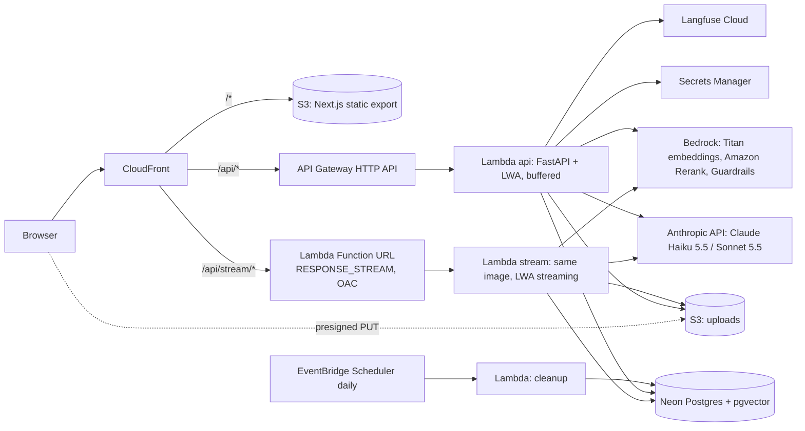

# JobMatch AI — Design

Status: draft for approval · Date: 2026-11-26

## 1. Intent and why

JobMatch AI takes a resume (PDF) and a job description and returns a match score, matched and missing skills with evidence, tailored resume bullets, and a grounded chat with citations over both documents.

The feature is the vehicle, not the point. The project exists to prove, in a portfolio, that the author can ship **production-grade LLM systems**: guardrails, evaluation, observability, cost control and reliability are first-class requirements. Every one of those must be visible to a recruiter (in the README, the eval report, and the running demo), not just present in code.

The author is a senior backend engineer (Python, FastAPI, LangGraph, AWS, Terraform, Next.js) using this project to learn RAG, pgvector/PostgreSQL, LLM evals, guardrails and LLM observability. Code should favour clarity and explicit, inspectable mechanisms over magic, because understanding the mechanism is part of the goal.

## 2. Users and access

- Users: the author, and recruiters who find the link on the author's resume. Anyone with the link can request access with an email address.
- **Access: self-built email one-time code (OTP), delivered via Resend from the author's domain** *(author's choice)*:
  1. `POST /api/auth/request-code {email}` → normalize email, create a 6-digit code (CSPRNG), store only its HMAC-SHA256 hash in Postgres (`login_codes`: email hash, code hash, expires_at = now+10 min, attempts, consumed_at); one active code per email (a new request invalidates the old). Send via Resend from `login@mail.<domain>`. Response is identical whether or not the email is new (no account enumeration).
  2. `POST /api/auth/verify {email, code}` → constant-time compare, max 5 attempts per code, then set a signed HTTP-only `SameSite=Lax`, `Secure` session cookie (7-day expiry). The user row (`users`: id, email, created_at, last_seen_at) is created on first successful verify.
  3. Abuse limits: code requests ≤3 per email per hour and ≤10 per IP per hour; Resend's free tier (~100 emails/day) is the hard ceiling and is monitored. Disposable-email domains are blocked with a small denylist.
- **Per-user allowance** (config): e.g. 5 analyses, 10 uploads and 30 chat messages per user per day. One heavy user can no longer starve everyone else. A **global daily spend cap (~$1/day)** remains only as a last-resort safety net.
- **Per-user analytics:** an `events` table (user id, event type: signed_up, logged_in, uploaded, analysed, chatted, guardrail_fired, quota_hit, with timestamps and cost) feeds a `make report` summary (users per day, funnel, cost per user, guardrail hits). Emails are stored for the author's own view only and are never sent to logs or Langfuse (traces use the user id).
- The user id owns all stored data; retrieval always filters by it (and by the current document set).
- A "Try with sample resume + JD" button runs the full flow on bundled synthetic documents so recruiters need not upload their own.
- No history across sessions. Uploaded documents and derived data auto-delete after **72 hours**.

## 3. Goals, non-goals, anti-goals

Goals
- The four core features (ingestion, match analysis, resume suggestions, grounded chat) working locally and deployed.
- Guardrails (input, output, topic) that are configurable, each logged when it fires, with measured catch rates.
- An eval suite (≥30 golden cases incl. adversarial) gating every PR in CI, plus a before/after report for the README.
- Per-request token/cost tracking, semantic caching, cheap-model routing, fallback, streaming, p50/p95 latency reporting.
- One-command local setup and one-command deploy; deployed cost ≲ $15/month.

Non-goals
- Multi-tenant SaaS, user accounts, billing, saved history.
- Supporting resume formats beyond text-based PDF (no OCR of scanned PDFs; DOCX is out).
- High availability / multi-region.

Anti-goals (would be a failure even if it "works")
- Suggestions or match output that invent experience or skills not in the resume.
- PII (phone, email, address) appearing in logs, traces, or Langfuse.
- A guardrail that silently fires (or silently fails open) without a logged event.
- Anything that bills hourly being created without the author's explicit go-ahead, or a surprise AWS bill.
- Eval numbers that look good because the dataset is too easy; the dataset must include cases the system currently fails.

## 4. Constraints

- Budget: $100 AWS credits; deployed system ≲ $15/month. AWS Budgets alerts at $10 and $25 (Terraform). Nothing hourly-billed without asking first.
- Stack (author's choice): Python 3.12, FastAPI, LangGraph, Pydantic; Claude via the **Anthropic API directly** (author's key; AWS credits do not cover Claude on Bedrock), called through LangChain/LangGraph (`langchain-anthropic`), not the raw Anthropic SDK — author's choice; AWS-native Bedrock services (Titan embeddings, Amazon Rerank, Guardrails) are covered by credits and stay on Bedrock; Postgres + pgvector; Lambda + API Gateway, S3, CloudFront; Terraform; Next.js + Tailwind; Langfuse; Docker Compose locally; pytest, type hints, ruff, pre-commit; GitHub Actions.
- Local dev runs without deployed AWS infra (Postgres in Docker). Claude and Bedrock calls use real keys locally (fetched from Secrets Manager, §7.8); tests run fully offline with a fake LLM provider.
- **Secrets (author's rule): every secret lives in AWS Secrets Manager. Nothing secret is committed, typed into a hand-written `.env`, or stored in GitHub.** A `.env` may exist only as a generated artifact (see §7.8).
- **Public GitHub repo; no credentials passed to GitHub** (see §8 CI).

## 5. Decisions made in conversation (Approaches)

### 5.1 Database hosting
| Option | Trade-off |
|---|---|
| A. RDS public endpoint, Lambda outside VPC | ~$13/mo (or free tier), keeps "RDS", public-DB trade-off to defend |
| B. RDS private + VPC endpoints | textbook, ~$25–30/mo — over budget (NAT ~$32/mo or endpoints ~$7/mo each) |
| **C. Neon serverless Postgres (chosen)** | ~$0/mo free tier, scales to zero, pgvector built in; not AWS; ~0.5–1 s cold start after idle |

Chosen: **Neon**, by the author, for cost. Lambda runs outside a VPC and connects over TLS — no NAT, no VPC endpoints, nothing hourly. Local dev uses the `pgvector/pgvector` Docker image so code is identical. The cold-start trade-off is documented in the README.

### 5.2 Guardrails
| Option | Trade-off |
|---|---|
| A. Bedrock Guardrails for everything | little code, managed; black box, no local/offline tests, whole-answer grounding only, per-call cost |
| B. All self-built layers | maximum learning, local, per-claim; most code, unknown blind spots |
| **C. Hybrid (chosen)** | self-built layered pipeline behind a `Guardrail` interface, Bedrock Guardrails (prompt-attack + PII) as a second pluggable provider; evals compare catch rates side by side |

Chosen: **C**, by the author. Local dev and CI run with Bedrock Guardrails disabled; a separate eval job enables it to produce the comparison table.

### 5.3 Access
| Option | Trade-off |
|---|---|
| Single shared invite code | simplest; no per-recruiter analytics, one heavy user exhausts the budget for all — rejected by the author |
| Cognito email OTP, default sender | no domain needed, AWS-native; ~50 emails/day, sender `no-reply@verificationemail.com` often lands in spam |
| Cognito + Resend via custom email sender trigger | Cognito JWTs; needs a KMS key (~$1/mo) + decrypting Lambda, more moving parts |
| **Self-built OTP + Resend on the author's domain (chosen)** | $0, small, fully controlled, branded mail with good deliverability; we own the security details listed in §2 |

SES was ruled out: new accounts start in the sandbox and production-access review takes from a day to weeks.

## 6. Architecture



Key points
- **Same-origin via CloudFront.** Frontend and API share one domain (`/api/*` routed by CloudFront), so the session cookie is first-party (`SameSite=Lax`) and there is no CORS. The Function URL is fronted by CloudFront with Origin Access Control.
- **One image, two Lambda functions.** FastAPI runs on the AWS Lambda Web Adapter (container image in ECR, because Presidio + spaCy exceed zip limits). LWA's invoke mode is per function, so the same image is deployed twice: `api` (buffered, behind API Gateway HTTP API — short routes only, all well under its fixed 30 s timeout) and `stream` (`RESPONSE_STREAM`, behind a Function URL — up to 15 min). *(Builder-check correction, my call.)*
- **Long work streams progress instead of blocking.** Ingestion and match analysis can exceed 30 s (cold start + Neon wake + several model calls), so they run on the `stream` function and send SSE progress events per graph step (e.g. "parsing → scanning for injection → embedding → done"). This avoids a jobs table and doubles as a nice UX showing the pipeline. *(My call.)*
- **Uploads go straight to S3** via presigned PUT (Lambda sync payloads cap at 6 MB and API Gateway base64-inflates binaries). The API only receives the S3 key. *(My call.)*
- **Function URL + CloudFront OAC:** OAC does not sign POST bodies for Lambda URLs, so the frontend sends an `x-amz-content-sha256` header (SHA-256 of the body via Web Crypto) on stream POSTs. *(My call.)*
- **Region: us-west-2.** Bedrock Rerank models are not offered in us-east-1; us-west-2 has Titan Embeddings V2, Amazon Rerank 1.0 and Guardrails. ACM certs for CloudFront still live in us-east-1 if a domain is added. *(My call.)*
- **Custom domain:** the author owns a domain (valid to 2029). The app runs at `jobmatch.<domain>` (CloudFront alias, free ACM certificate in us-east-1, DNS-validated). DNS stays at the author's current registrar: Terraform outputs the CNAME/TXT records to add by hand, so no Route 53 hosted zone ($0.50/mo) is needed. Resend sends from the subdomain `mail.<domain>` (its SPF/DKIM/MX records also added at the registrar, plus a DMARC record), so the root domain's reputation is isolated.
- **Local:** `docker compose up` runs Postgres+pgvector and the API (uvicorn) and the Next.js dev server. Langfuse is optional locally (Cloud keys or disabled).

### 6.1 Main flows
1. **Upload** `POST /api/uploads` returns a presigned PUT (content-type and size conditions) → browser PUTs to S3 → `POST /api/stream/documents {s3_key, doc_type}` streams progress: validate (magic bytes, size, page count) → parse → PII redaction for logging → injection scan → chunk → embed → store.
   The JD may instead be **pasted text** (`POST /api/stream/documents {text, doc_type: "jd"}`). One resume and one JD per session; uploading a new one replaces the old one and invalidates that session's cache and analyses. *(My call.)*
2. **Analyse** `POST /api/stream/analyses` → LangGraph match graph with progress events → validated `MatchAnalysis` JSON as the final event.
3. **Suggest** `POST /api/suggestions` → LangGraph suggestion graph → validated `BulletSuggestions`.
4. **Chat** `POST /api/stream/chat` (SSE) → LangGraph chat graph → streamed tokens + citations + final guard verdict event.

## 7. Components

### 7.1 Model provider layer
- Interfaces: `ChatModelProvider` (returns a LangChain `BaseChatModel` per role), `Embedder`, `Reranker`. Implementations: `AnthropicChatProvider` (`langchain-anthropic` `ChatAnthropic`), `BedrockEmbedder` (Titan V2), `BedrockReranker` (Amazon Rerank 1.0), and fakes for tests (`FakeListChatModel`-style deterministic models, hash-based embedder, identity reranker). Swapping provider = new class + config, no graph changes.
- **Models:** default `claude-haiku-5-5` ($0.10 / $0.50 per MTok input/output); strong `claude-sonnet-5-5` ($2 / $10). IDs in config. `max_tokens` set explicitly per call site. Effort set explicitly (`low` for classifiers/guards, `medium` for generation) — Haiku 5.5 defaults to adaptive thinking at `medium`.
- **Structured output gotcha:** Sonnet 5.5 rejects forced `tool_choice` (400), which is what LangChain's default tool-calling structured output uses. Use the native structured-outputs method (`with_structured_output(..., method="json_schema")`) or `tool_choice=auto` + strict tools; verify against the installed `langchain-anthropic` version.
- **Prompt caching:** system prompt + document context placed first with `cache_control`, so repeated chat turns over the same documents read from cache.
- **Model router** (config-driven): Haiku for classification, chat and first attempt at structured tasks; escalate to Sonnet when structured validation fails twice, or the input exceeds a size threshold.
- **Reliability:** per-call timeout; retries with exponential backoff + jitter only on retryable errors (429, 5xx/overloaded, connection errors — never 400/401/404); fallback Haiku→Sonnet (and Sonnet→Haiku) on exhaustion via LangChain `with_fallbacks`; user-facing errors are friendly and carry a request id.
- **Embeddings:** Titan Text Embeddings V2, 1024 dims, normalized. **Reranker:** Amazon Rerank 1.0 on Bedrock behind the same interface; a no-op reranker locally/offline.

### 7.2 Ingestion
- Parse PDF with `pypdf` (text-based PDFs only; reject if extracted text is empty → "scanned PDFs not supported").
- Resume chunking by detected section (Experience, Education, Skills, Projects, Summary…) via heading heuristics; within Experience, one chunk per role/bullet group, capped ~400 tokens with small overlap. JD chunked by section (Responsibilities, Requirements, Nice-to-have…).
- Table `chunks(id, user_id, doc_id, doc_type{resume,jd}, section, ordinal, text, embedding vector(1024), tsv tsvector, created_at)`, HNSW index on embedding, GIN on tsv. Every query filters by `user_id` and the active `doc_id`s.

### 7.3 Retrieval (hybrid)
- Vector top-k (cosine) + Postgres full-text top-k (`websearch_to_tsquery`), fused with Reciprocal Rank Fusion, then reranked, top-n passed to generation. Chunk ids become citation ids.

### 7.4 LangGraph workflows
- **Chat graph:** `input_guards → topic_router → (refuse | retrieve) → rerank → generate(stream) → output_guards → finalize`. Answers must cite chunk ids inline (`[r3]`, `[j1]`). If retrieval returns nothing relevant, refuse ("not in the documents").
- **Match graph:** `extract_jd_requirements(structured) → extract_resume_skills(structured) → match_with_evidence → score → validate(hallucination block) → finalize`.
  - Score is **computed deterministically** from matched requirements weighted by importance (required vs nice-to-have), not chosen freely by the LLM — this makes it explainable and eval-able.
- **Suggestion graph:** `select_relevant_bullets → rewrite(structured, cites source bullet) → validate(no new skills/employers/metrics not present in source) → finalize`.

### 7.5 Structured outputs
Pydantic models for every input/output (`MatchAnalysis`, `SkillMatch{skill, status, evidence[{chunk_id, quote}]}`, `BulletSuggestion{original_chunk_id, original, rewritten, rationale}`, `ChatAnswer`). Structured calls use tool-use/JSON schema; on validation failure, retry with the validation error fed back (max 2), then escalate model, then fail gracefully.

### 7.6 Guardrails (hybrid)
- Interface: `Guardrail.check(ctx) -> GuardrailResult(action: allow|redact|flag|block, reason, provider, latency_ms)`. A `GuardrailPipeline` runs an ordered, config-defined list per stage (`upload`, `chat_input`, `output`). Each guardrail and provider is toggleable via settings (env / YAML), with mode `enforce` or `monitor` (log only).
- **Every firing writes a `guardrail_events` row** (request id, session id, stage, guardrail, provider, action, reason — never raw PII) and a Langfuse span event.

| Stage | Guardrail | Self-built | Bedrock provider |
|---|---|---|---|
| upload | file validation | MIME sniff, extension, ≤5 MB, ≤10 pages | — |
| upload / chat_input | prompt injection (incl. hidden in documents) | pattern rules + Haiku classifier on chunks | prompt-attack filter via `ApplyGuardrail` |
| logging boundary | PII redaction (phone, email, address) | regex + Presidio (spaCy small model) | PII filter `ANONYMIZE` |
| chat_input | topic control | Haiku classifier → polite refusal | denied topics (optional) |
| chat_input | rate limit / allowance | per-user daily allowance + short-window token bucket in Postgres, global daily spend cap as backstop | — |
| output | schema validation | Pydantic + retry | — |
| output | groundedness (per claim) | split answer into claims, judge each against cited chunks (Haiku) | contextual grounding check (whole answer) for comparison |
| output | hallucination block | every skill/employer/title in output must be found in resume chunks (normalized string + embedding match) | — |
| output | refusal when unanswerable | retrieval-relevance threshold + judge | — |

- Injection found inside an uploaded document: the offending chunk is quarantined (stored, flagged, excluded from prompts) and the user is told; the rest of the document proceeds.
- **Streaming vs. output checks:** chat streams tokens immediately; the per-claim groundedness check runs on the completed answer and emits a final `verdict` SSE event. If it fails, the UI replaces the answer with a refusal/flagged state. (Trade-off: a user may briefly see an ungrounded sentence; buffering would kill streaming latency. Documented in README.)
- Bedrock Guardrails use a numbered version (never DRAFT) and `trace: disabled`.
- **Deployed demo:** self-built guardrails run in `enforce`; the Bedrock provider runs in `monitor` mode on uploads and chat input (prompt-attack + PII), so the "Show guardrails" panel can display both verdicts side by side. Cost is fractions of a cent per call and can be toggled off by config. *(My call.)*

### 7.7 Observability and cost
- **Langfuse Cloud (free tier)** traces every request: graph nodes as spans, LLM generations with model, tokens, cost, latency, prompt version. Prompts live in the repo (`prompts/`), versioned and tagged on traces.
- **PII never leaves redaction:** a single redaction function is applied to everything before it reaches logs (structlog processor) or Langfuse (masking hook).
- `request_log` table: request id, route, model(s), input/output tokens, cost USD (from a pricing table in config), cache hit, latency, guardrail outcomes. A `make report` script computes p50/p95 latency and cost per request type.
- **Semantic cache:** pgvector table keyed by (document-set hash, query embedding); hit when cosine ≥ threshold (config, ~0.95) and same documents; TTL 72h. Applies to chat and analysis; bypassed when a guardrail flagged the request.
- **Spend controls:** per-user daily allowance (§2) first; a global daily model-spend cap (Anthropic + Bedrock, ~$1/day, config) as a backstop. Each limit returns its own friendly message ("you've used today's 5 analyses — resets at midnight UTC" vs. "the demo is at capacity today").

### 7.8 Security
- **All secrets in AWS Secrets Manager**, one JSON secret per environment (`jobmatch/dev`, `jobmatch/prod`; ≈$0.40 each/month) with keys: `ANTHROPIC_API_KEY`, `DATABASE_URL` (Neon), `LANGFUSE_PUBLIC_KEY`, `LANGFUSE_SECRET_KEY`, `SESSION_SIGNING_KEY`, `OTP_HMAC_KEY`, `RESEND_API_KEY`.
- **Terraform creates the secret containers but never their values**, so no secret ever lands in Terraform state or the repo. The author sets values once with `aws secretsmanager put-secret-value` (a `make secrets-set` helper prompts with hidden input).
- **Deployed:** Lambda reads `jobmatch/prod` from Secrets Manager at cold start and caches it in memory — no `.env` is baked into the image (secrets in image layers are recoverable from ECR).
- **Local:** `make env` pulls `jobmatch/dev` with the author's AWS credentials and generates a git-ignored `.env` (mode 600) that Docker Compose reads. Alternatively the app can read Secrets Manager directly when `SECRETS_SOURCE=aws`. `.env` is never hand-edited or committed; `.gitignore` and a pre-commit secret scanner (gitleaks) enforce it.
- Least-privilege IAM: Lambda role limited to the Titan and Rerank model ARNs, the guardrail ARN, `secretsmanager:GetSecretValue` on `jobmatch/prod` only, the uploads bucket prefix, named secrets, its own log group.
- CloudWatch log retention 14 days; Bedrock model-invocation logging off.
- S3 uploads: private, SSE, block public access, 3-day lifecycle expiry as a backstop only (lifecycle is day-granular and asynchronous).

### 7.9 Data lifecycle
EventBridge Scheduler triggers a cleanup Lambda hourly (free-tier invocations): deletes S3 objects, chunks, analyses, cache entries, and login codes and logs for documents older than 72h (guardrail_events, request_log and events keep aggregate fields only, no text). `users` rows (email) are kept for analytics; the author can purge them with `make purge-users`.

## 8. Evaluation
- **Golden dataset** (`evals/dataset/`): ≥30 synthetic resume/JD pairs generated with an LLM and hand-curated, stored as text + rendered PDFs + expected outputs (expected matched/missing skills, score band, Q&A pairs with expected answer and supporting chunk ids). Categories: strong match, partial, poor match, career changer, missing information, prompt injection in resume, injection in JD, injection in chat, off-topic chat, PII-heavy resume, requests to fabricate experience. No real resumes.
- **Framework: DeepEval** (pytest-native, fits CI) with Claude Sonnet 5.5 (Anthropic API) as judge. Metrics: faithfulness, answer relevancy, contextual precision, contextual recall. Custom metrics: skill-extraction F1, score-band accuracy, guardrail catch rate and false-positive rate per guardrail and per provider (self-built vs Bedrock vs both), hallucination-block rate, refusal correctness.
- **CI (GitHub Actions), public repo, no stored credentials** *(author's choice: OIDC)*:
  - Every PR (including forks): lint, type check, unit tests, offline guardrail tests — no secrets needed.
  - PRs from branches in the author's own repo: eval job. GitHub OIDC → AWS role `jobmatch-ci` whose trust policy is pinned to `repo:<owner>/<repo>` and `pull_request`/`push` on `main`; the role may only `GetSecretValue` on `jobmatch/ci` (a separate Anthropic key with its own low spend limit) and invoke Titan/Rerank. No secret is stored in GitHub. Fork PRs receive no OIDC token, so the eval job is skipped for them (job condition on `head.repo.full_name == github.repository`). Workflows use `pull_request`, never `pull_request_target`.
  - CI evals run a fixed cheap subset; the full suite runs on push to `main` and on PRs labelled `full-eval`. Thresholds in `evals/thresholds.yaml`; build fails below them. The job posts a markdown report as a PR comment and uploads JSON.
- **Before/after:** `evals/baseline.json` is captured from a naive baseline (vector-only retrieval, no rerank, no guardrails) so the README table shows the improvement from each technique.
- Expected eval cost with Haiku 5.5 as the system model and Sonnet 5.5 as judge: roughly $0.10–0.50 per full run (to be measured in Phase 6 and reported).

## 9. Frontend
Next.js (static export) + Tailwind on S3/CloudFront. Screens: landing (email → code sign-in, sample button) → upload → results (score, matched/missing skills with evidence quotes, suggestions with original vs rewritten) → chat (streaming, clickable citations that highlight source chunks). A "Show guardrails" panel lists which guardrails ran and fired for each response, which makes the engineering visible to recruiters.

## 10. Infrastructure and deployment
- Terraform with remote state in S3 (native lockfile). Modules: `network-free` edge (CloudFront, S3 sites), `api` (ECR, Lambda, Function URL, API Gateway HTTP API, IAM), `data` (Neon project via the Neon Terraform provider, S3 uploads), `secrets`, `guardrails` (Bedrock guardrail + version), `ops` (Budgets $10/$25 alerts, log groups, cleanup schedule), `ci` (GitHub OIDC provider + role).
- `make up` (local), `make deploy` (build image → push → terraform apply → build/sync frontend → invalidate CDN).
- **Hourly-billed resources: none planned.** Estimated monthly: Lambda/API GW/S3/CloudFront ≈ $0–1 (free tier), Secrets Manager ≈ $1–2, ECR ≈ $0.10, Bedrock (Titan/Rerank/Guardrails) ≈ $0–1. **AWS total ≈ $2–4.** Resend free tier $0. Anthropic API is billed separately to the author's key: demo traffic capped at ~$1/day worst case by the backstop cap (expected far lower at Haiku 5.5 prices), plus CI evals as above. The author is asked before applying anything that bills hourly.

## 11. Repository layout
```
jobmatch-ai/
├── backend/
│   ├── app/
│   │   ├── api/            # FastAPI routers, deps, session auth
│   │   ├── core/           # settings, logging (redaction), errors
│   │   ├── llm/            # provider protocol, bedrock, fake, router, pricing
│   │   ├── ingestion/      # pdf parse, chunking, embedding
│   │   ├── retrieval/      # hybrid search, RRF, rerank
│   │   ├── graphs/         # LangGraph chat / match / suggestion
│   │   ├── guardrails/     # interface, pipeline, self-built + bedrock providers
│   │   ├── cache/          # semantic cache
│   │   ├── observability/  # langfuse, request_log, metrics
│   │   ├── db/             # SQLAlchemy models, alembic migrations
│   │   └── schemas/        # Pydantic I/O models
│   ├── prompts/
│   ├── tests/{unit,integration}/
│   ├── Dockerfile          # Lambda image (LWA)
│   └── pyproject.toml      # uv, ruff, mypy, pytest
├── evals/{dataset,metrics,runners}/, thresholds.yaml, baseline.json
├── frontend/               # Next.js + Tailwind
├── infra/terraform/{modules,envs/prod}/
├── docs/{superpowers/specs,adr,assets}/
├── .github/workflows/{ci.yml,evals.yml,deploy.yml}
├── docker-compose.yml
├── Makefile
├── .pre-commit-config.yaml
└── README.md
```

## 12. Phases
Each phase ends with a summary of what was built and how to test it.
1. Skeleton: repo, uv/ruff/mypy/pre-commit, Docker Compose with pgvector, FastAPI `/health` (checks DB + pgvector extension), CI lint/test job.
2. Ingestion + basic RAG chat locally (vector-only first; capture baseline), then hybrid + rerank + citations + streaming.
3. Structured match analysis + resume suggestions with schema validation/retry.
4. Guardrails: interface, pipeline, self-built guardrails, Bedrock provider, event logging.
5. Langfuse tracing, cost tracking, semantic cache, model routing and fallback, spend cap, latency report.
6. Golden dataset, DeepEval suite, CI gating, report generation.
7. Terraform + AWS deploy + budgets + cleanup job (confirm before any apply).
8. Next.js frontend, README (diagram, decisions, eval table, cost per request, guardrail examples, demo GIF), LinkedIn write-up.

## 13. Left to the builder
- Exact chunk sizes, k values, RRF constant, cache and grounding thresholds — tune with evals.
- Section-detection heuristics for resumes.
- Pattern list for injection rules and the classifier prompt.
- SQLAlchemy vs psycopg raw queries (SQLAlchemy 2 + Alembic suggested).
- UI visual details.
